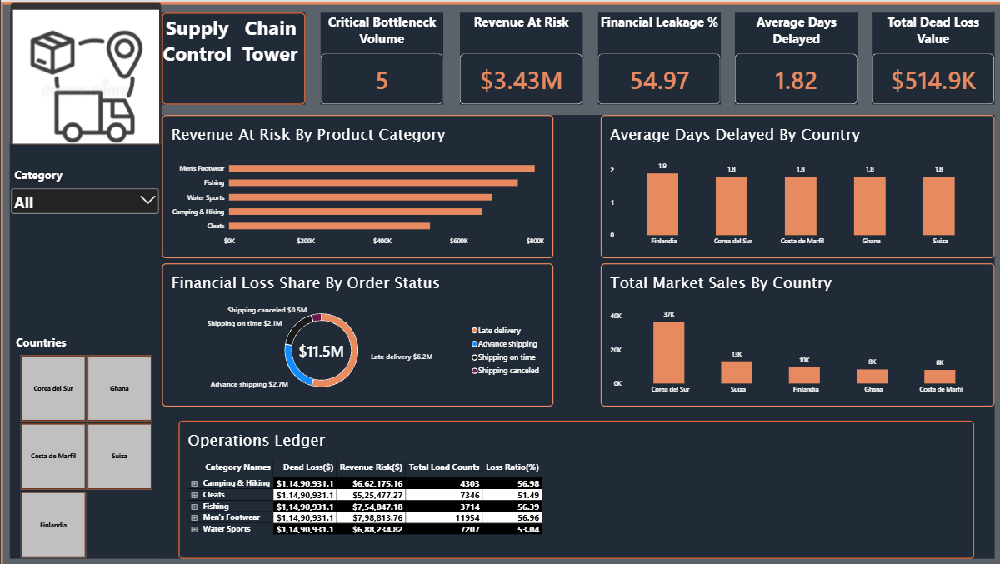

# Supply Chain Analytics

An end-to-end data project built with **Python, MySQL, and Power BI** to track late deliveries, canceled orders, and money at risk across **180,000+ global supply chain orders**.

## What This Project Does
When a company ships thousands of orders every day, small delivery delays and canceled orders silently eat away at profits. Instead of scrolling through massive spreadsheets, this project cleans the raw order data and gives managers a single screen to spot shipping bottlenecks and save money.

## How I Built It
* **Cleaning & Loading (`Cleanandload.py`):** Used Python to read the heavy 93 MB raw CSV file, clean up messy rows, and push everything safely into MySQL without crashing.
* **Finding the Problems (`MySQL`):** Created the database (`Create_db_and_table.sql`) and wrote three focused SQL queries to catch where money was leaking:
  * `Country_Delays.sql` — Finds which countries have the most late deliveries.
  * `Order_Dead_Loss.sql` — Counts canceled and fraud orders where the company lost money.
  * `Revenue_at_Risk.sql` — Calculates the exact dollar value stuck inside delayed shipments.
* **Visualizing the Results (`suppy-chain-dashboard.pbix`):** Connected the clean SQL data to Power BI so managers can see late shipping hotspots and revenue risks in seconds.

## Key Takeaways for the Business
1. **Fix Slow Shipping Routes First:** Pinpoints the exact countries missing delivery dates so logistics teams can switch slow delivery partners.
2. **Stop Canceled Order Losses:** Separates failed and fraud orders from real sales so warehouses don't waste money packing bad orders.
3. **Save High-Value Orders:** Shows which delayed shipments carry the biggest money value so dispatch teams can push them out first.
